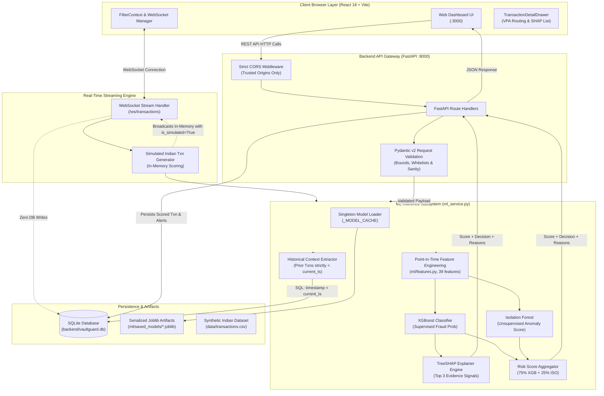
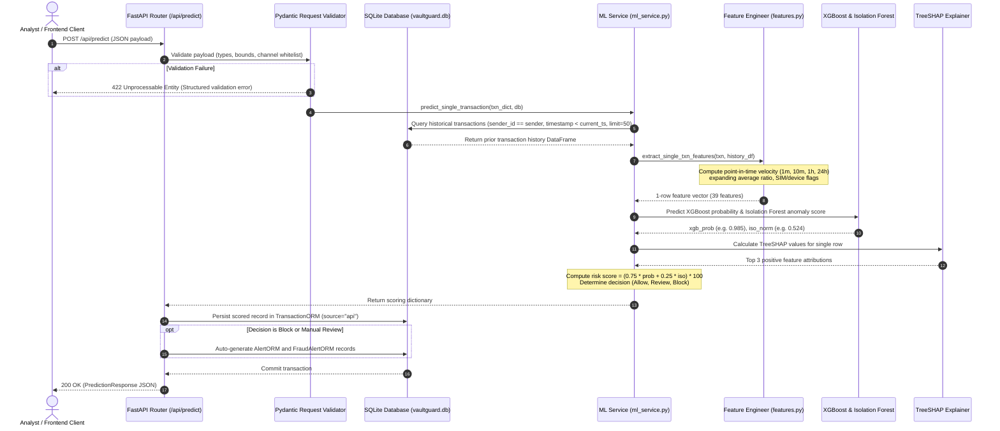
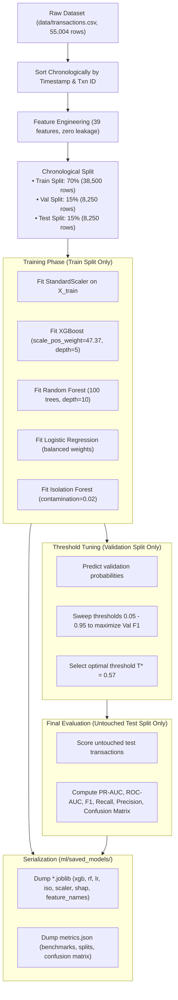

# VaultGuard System Architecture

This document describes the technical architecture, data flows, components, and security trust boundaries of **VaultGuard — Fraud Detection in Small Transactions**.

---

## 1. System Architecture Diagram

---

## 2. Prediction Request Lifecycle

The sequence below illustrates the end-to-end lifecycle when a transaction is submitted for scoring via `POST /api/predict`:

---

## 3. Model Training & Evaluation Lifecycle

The offline pipeline in [`ml/train.py`](file:///c:/Users/udays/OneDrive/Attachments/Desktop/fraud/ml/train.py) trains, tunes, evaluates, and serializes the machine learning models:

---

## 4. Persisted vs. Simulated Transactions Architecture

A critical architectural distinction in VaultGuard is the separation between **persisted database transactions** and **simulated streaming events**:

| Dimension | Persisted Transactions (`source="seed"` or `"api"`) | Simulated Stream Events (`source="websocket_simulation"`) |
| :--- | :--- | :--- |
| **Origin** | Seed CSV import or authenticated `POST /api/predict` calls | In-memory synthetic generator in `websocket.py` |
| **Storage** | Persisted in SQLite `transactions` and `alerts` tables | **Zero database writes**; broadcast strictly in-memory |
| **Database Impact** | Included in total transaction counts and analytics KPIs | Does not alter database counts or skew fraud ratios |
| **Frontend Visibility** | Transactions explorer ledger, investigation cases | Live stream ticker and floating notifications |
| **UI Flagging** | Rendered as official ledger records | Explicitly tagged with `"is_simulated": True` and visual stream badge |

---

## 5. Current Trust Boundaries & Architectural Limitations

1. **Client / Server Boundary**:
   - Client-side validation in the React UI provides immediate user feedback, but server-side validation in FastAPI via Pydantic v2 remains the authoritative security boundary.
   - All string fields, amounts, and payment channels are sanitized and validated at the API boundary before reaching the ML service.
2. **Database Concurrency & Locking**:
   - SQLite enforces database-level write locks. While read operations are concurrent, continuous high-concurrency write bursts can cause lock contention. In enterprise production, the persistence layer must be migrated to PostgreSQL.
3. **Administrative Access**:
   - The model retraining endpoint (`POST /api/models/retrain`) is guarded by a concurrency mutex lock and an optional `X-Admin-Token` header. Full multi-tenant role-based access control (RBAC) with JSON Web Tokens (JWT) is planned for future phases.
4. **CORS & Network Scope**:
   - CORS is explicitly locked to trusted local development origins (`http://localhost:3000`, `http://127.0.0.1:3000`, `http://localhost:5173`, `http://127.0.0.1:5173`) with environment variable override (`ALLOWED_ORIGINS`).
