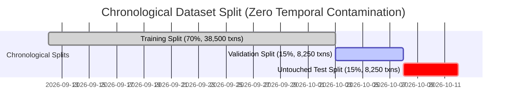

# VaultGuard Machine Learning Methodology & Reliability Report

This document details the machine learning design, temporal feature engineering, model benchmarking, threshold optimization, explainability architecture, and synthetic data provenance for **VaultGuard — Fraud Detection in Small Transactions**.

---

## 1. Synthetic Dataset Architecture & Limitations

The dataset in [`data/transactions.csv`](file:///c:/Users/udays/OneDrive/Attachments/Desktop/fraud/data/transactions.csv) was created via [`ml/generate_data.py`](file:///c:/Users/udays/OneDrive/Attachments/Desktop/fraud/ml/generate_data.py) using a fixed random seed (`SEED = 42`) to guarantee deterministic reproducibility.

### Dataset Specifications
- **Total Transactions**: 55,004 records.
- **Time Horizon**: 30 consecutive calendar days (2026-09-12 12:00:41 to 2026-10-12 11:59:11).
- **Fraud Prevalence**: ~2.36% overall (1,301 fraud transactions, 53,703 legitimate transactions).
- **Payment Channels**:
  - UPI P2M QR: 45% (kirana stores, food/dining, digital services, retail, pharmacies).
  - UPI P2P: 35% (peer-to-peer transfers via Virtual Payment Addresses).
  - Digital Wallets: 10% (prepaid instruments, merchant checkouts).
  - IMPS: 5% (immediate bank-to-bank retail remittances).
  - RuPay Cards: 5% (debit/credit card clearing).

### Modeled Small-Transaction Fraud Scenarios
1. **SIM Swap Account Takeover (ATO)**:
   - *Signature*: A recent SIM swap indicator (`sim_change_flag = 1`) coupled with an unverified new device ID (`is_new_device = 1`) and a high-value transfer (₹2,000–₹9,500) to an unfamiliar beneficiary VPA.
2. **UPI Micro-Testing Probes**:
   - *Signature*: Successive micro-transfers (₹1.00–₹25.00) initiated in rapid succession (< 60 seconds) to test card/account authorization validity on POS or QR terminals.
3. **Mule QR Terminal Velocity Spikes**:
   - *Signature*: Inactive or low-volume merchant QR terminals suddenly receiving concentrated volume bursts exceeding 3.0x to 5.0x their expanding 24-hour baseline.
4. **Regulatory Amount Structuring (Smurfing)**:
   - *Signature*: Amounts clustered within 2% directly below Indian regulatory surveillance thresholds: ₹990–₹999, ₹1,990–₹1,999, ₹4,950–₹4,999, and ₹9,900–₹9,999.
5. **New Beneficiary Bursts**:
   - *Signature*: Multiple back-to-back transfers (4–7 transactions within 10 minutes) sent to recipient VPAs that have zero prior transaction history with the sender.
6. **Phishing Collect Request Authorizations**:
   - *Signature*: Incoming UPI collect-request authorizations targeting senior or unverified customer accounts.

---

## 2. Leakage-Safe Feature Engineering

The feature extraction pipeline in [`ml/features.py`](file:///c:/Users/udays/OneDrive/Attachments/Desktop/fraud/ml/features.py) produces **39 numerical features** while strictly enforcing zero temporal leakage:

```text
Feature Vector (39 Features):
├── Amounts & Flags (4)
│   ├── amount
│   ├── is_small_amount (< ₹100)
│   ├── is_just_below_threshold (structuring check)
│   └── amount_to_avg_ratio (expanding baseline ratio)
├── Temporal Context (3)
│   ├── hour_of_day
│   ├── day_of_week
│   └── is_night (23:00 - 05:00)
├── Security & Device Signals (4)
│   ├── is_new_device
│   ├── sim_change_flag
│   ├── high_risk_device_action (new_device & sim_change)
│   └── time_since_last_txn (seconds since sender's prior txn)
├── Sender Velocity Windows (4)
│   ├── txn_count_1min  (closed='left')
│   ├── txn_count_10min (closed='left')
│   ├── txn_count_1hour (closed='left')
│   └── txn_count_24h   (closed='left')
├── Beneficiary & Terminal Dynamics (2)
│   ├── is_new_beneficiary (point-in-time cumcount == 0)
│   └── merchant_spike_ratio (1h count / (24h count / 24 + 1))
├── Legacy Compatibility (2)
│   ├── geo_mismatch
│   └── high_risk_bin
└── One-Hot Encodings (20)
    ├── channel_* (5 categories)
    ├── txn_type_* (4 categories)
    └── merchant_cat_* (9 categories)
```

### Mathematical Guarantees Against Data Leakage:
1. **Velocity Rolling Counts**: All rolling windows use `closed='left'` in pandas:
   $$\text{count}_{[t - W, t)} = \sum_{i : t - W \le \tau_i < t} 1$$
   The current transaction at timestamp $t$ is strictly excluded from its own rolling window.
2. **Expanding Average Ratio**: Computed strictly using transactions preceding the current row:
   $$\text{Prior Avg} = \frac{\sum_{i=1}^{k-1} A_i}{k - 1}, \quad \text{Ratio} = \frac{A_k}{\text{Prior Avg} + 1.0}$$
3. **Database Lookback Isolation**: In real-time inference (`ml_service.py`), historical lookback explicitly queries `WHERE timestamp < current_ts`.

---

## 3. Chronological Dataset Partitioning

To mirror real-world production deployment where models are trained on past data and evaluated on future transactions, VaultGuard rejects random $K$-fold cross-validation in favor of **strict chronological index splitting**:



- **Train Split (70%)**: 38,500 transactions. Fraud rate: 2.07% (796 frauds).
- **Validation Split (15%)**: 8,250 transactions. Fraud rate: 2.82% (233 frauds).
- **Untouched Test Split (15%)**: 8,250 transactions. Fraud rate: 2.19% (181 frauds).

---

## 4. Multi-Model Benchmarking & Evaluation

Four distinct architectures were evaluated on the chronological splits:
1. **Logistic Regression**: Linear baseline with balanced class weights and standardized scaling.
2. **Random Forest Classifier**: Ensemble baseline with 100 trees and depth 10.
3. **XGBoost Classifier**: Gradient boosted decision trees with `scale_pos_weight = 47.37`, learning rate 0.08, and depth 5.
4. **Isolation Forest**: Unsupervised anomaly detection baseline (`contamination = 0.02`).

### Benchmarks on Untouched Test Set (8,250 Transactions)

| Model Architecture | PR-AUC | ROC-AUC | F1-Score | Recall | Precision | FPR | Optimal Threshold ($T^*$) |
| :--- | :--- | :--- | :--- | :--- | :--- | :--- | :--- |
| **XGBoost Classifier** | **0.9986** | **1.0000** | **0.9861** | **0.9834** | **0.9889** | **0.02%** | **0.57** (tuned on Val) |
| **Random Forest** | 0.9969 | 0.9999 | 0.9777 | 0.9669 | 0.9887 | 0.02% | 0.57 (tuned on Val) |
| **Logistic Regression** | 0.9648 | 0.9979 | 0.9183 | 0.9006 | 0.9368 | 0.14% | 0.94 (tuned on Val) |
| **Isolation Forest** | 0.5642 | 0.8959 | 0.5714 | 0.4751 | 0.7167 | 0.42% | 0.61 (tuned on Val) |

### Validation-Only Decision Threshold Tuning
The decision threshold was selected by sweeping candidates from 0.05 to 0.95 exclusively on the **Validation Split** to maximize validation $F_1$:
$$T^* = \arg\max_{T} F_1(\mathbf{y}_{\text{val}}, \mathbf{\hat{y}}_{\text{val}}(T))$$
The optimal threshold ($T^* = 0.57$) was frozen and applied to the untouched test set without post-hoc tuning.

### Confusion Matrix on Untouched Test Set (XGBoost)
$$\begin{pmatrix} \text{TN} = 8,067 & \text{FP} = 2 \\ \text{FN} = 3 & \text{TP} = 178 \end{pmatrix}$$
- **False-Positive Rate**: $2 / 8,069 = 0.02\%$
- **False-Negative Rate**: $3 / 181 = 1.66\%$

---

## 5. Why High Test Metrics Do Not Prove Real-World Accuracy

The observed test precision (98.9%) and recall (98.3%) are exceptionally high. It is critical for engineering transparency to document why:

1. **Synthetic Separability**: The synthetic generator constructs fraud patterns with distinct feature combinations (e.g., `sim_change_flag = 1` combined with `is_new_device = 1`). Benign synthetic transactions rarely exhibit this combination. Decision trees can isolate these rules with near-perfect separation.
2. **Absence of Real-World Behavior Noise**: In real banking systems:
   - Benign customers regularly purchase new phones, swap SIM cards, travel abroad, or experience transient network retries that look like micro-velocity.
   - Fraudsters actively evade detection by staggering payments across days, using aging mule accounts, and rotating IP addresses.
3. **No Delayed Reporting or Label Noise**: Real fraud labels suffer from a 30–90 day chargeback delay, friendly fraud, and misreporting. The synthetic dataset has 100% deterministic, immediate ground-truth labels.
4. **Academic Reality**: **The high evaluation metrics demonstrate that the ML pipeline correctly learns the intended patterns without feature leakage, but they DO NOT imply that the model would achieve 98%+ precision on live commercial bank logs.** Real-world production fraud detection systems typically achieve PR-AUC between 0.35 and 0.75.

---

## 6. Hybrid Risk Scoring & SHAP Explainability

### Hybrid Score Calibration
To provide both supervised pattern recognition and unsupervised zero-day anomaly detection, the final risk score combines both models:
$$\text{Risk Score} = \left[ 0.75 \times P_{\text{XGB}}(\text{Fraud}) + 0.25 \times S_{\text{ISO}}(\text{Anomaly}) \right] \times 100$$
- **0.0 – 40.0**: `Allow` / `LOW_RISK`
- **40.1 – 70.0**: `Manual Review` / `REVIEW`
- **70.1 – 100.0**: `Block` / `HIGH_RISK`

### TreeSHAP Local Explanations
For every scored transaction, [`ml/predict.py`](file:///c:/Users/udays/OneDrive/Attachments/Desktop/fraud/ml/predict.py) executes `shap.TreeExplainer` on the fitted XGBoost model:
$$\phi_0 + \sum_{j=1}^{M} \phi_j(\mathbf{x}) = f(\mathbf{x})$$
The positive SHAP attributions ($\phi_j > 0$) are ranked to surface the **top 3 human-readable evidence reasons** explaining why the score was elevated.

**Explainability Boundary**: SHAP values quantify the marginal contribution of each feature to the model's mathematical output. They represent **statistical feature attributions**, not definitive legal proof of fraud.
